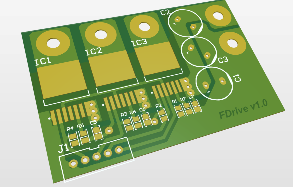

# FDrive
High-current 3-phase power stage driver designed for FOC control of BLDC/PMSM motors.
<table>
  <tr>
    <td width="50%" align="center">
      
       
    </td>
    <td width="50%" align="center">
      
       
    </td>
  </tr>
</table>

## 🚀 Key Features

* **Control Compatibility:** Designed to work with external microcontrollers (STM32, ESP32, Arduino, etc.) running Field-Oriented Control (FOC) or 6-step commutation algorithms.
* **Power Stage:** Triple Infineon BTN7960 half-bridge ICs delivering high-current capability with integrated thermal and current protection.
* **Application:** Built as a high-power 3-phase inverter stage for brushless DC (BLDC) and PMSM motor control systems.

## Demo
Test with velocity mode and position mode
<table>
  <tr>
    <td width="50%" align="center">
      <video src="https://github.com/user-attachments/assets/580550fb-ced1-4705-a24c-dcd15c0853f7" controls width="100%"></video>
       
      <b>FDrive</b> - Test Video 1
    </td>
    <td width="50%" align="center">
      <video src="https://github.com/user-attachments/assets/6849a1d4-4c6d-4fc8-9c0a-42d315c67e0e" controls width="100%"></video>
       
      <b>FDrive</b> - Test Video 2
    </td>
  </tr>
</table>

